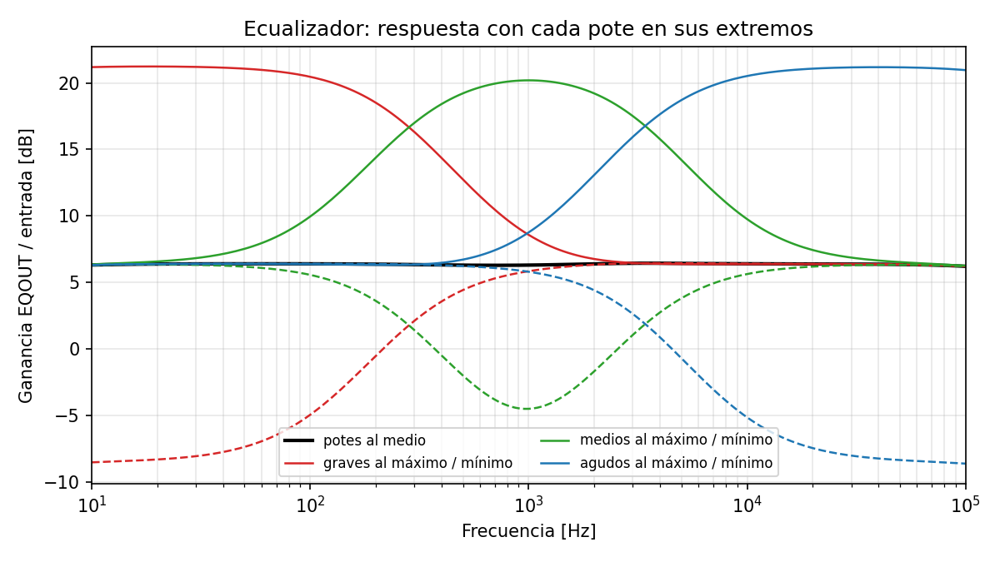
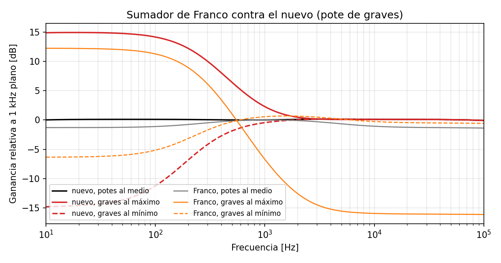
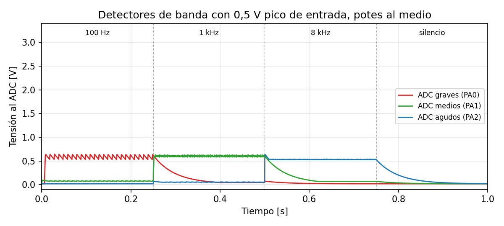
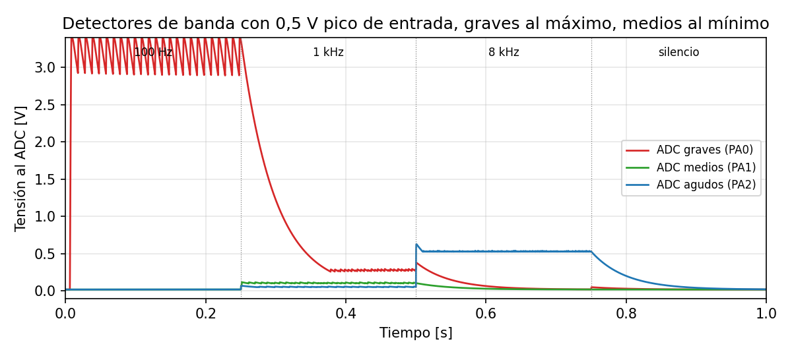
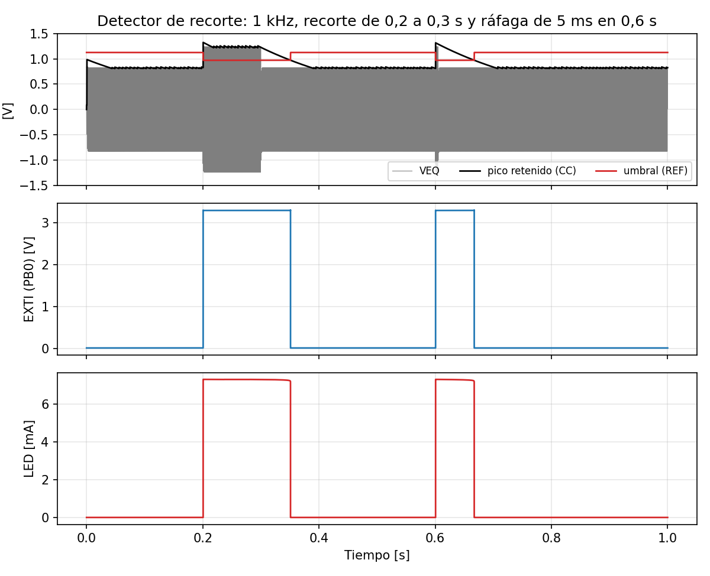

# Ecualizador de 3 bandas: cálculo y simulación (etapa 1)

**Base:** el ecualizador de Franco Palombo (repo `fpp3/ElectronicaAplicada2`, `tp4/sources/ampli.kicadproj/3band_eq.kicad_sch` y `sim/eq.asc`). Se mantienen sus filtros de graves y de la banda media; cambian el sumador, el agudo y la ganancia de la banda media, y se agregan los detectores para el Blue Pill.

**Archivos:** el circuito está en `eq_audio.inc` (de la entrada a `EQOUT`) y `eq_detectores.inc` (hacia el Blue Pill); cada `.cir` es una simulación. `python correr_simulaciones.py` corre todo en LTspice 24 (unos 7 min), escribe `resultados.json` y las figuras de `figuras/`.

**Modelos:** TL084/TL082 de TI (`tl08x.lib`, el mismo del TP4). Contra la hoja de datos: GBW = 282,8 µS / (2π · 15 pF) = 3,0 MHz y SR = 195 µA / 15 pF = 13 V/µs, iguales a los típicos (3 MHz y 13 V/µs). 1N4148, BAT46WJ, BC547B y el LED rojo QTLP690C salen de las bibliotecas estándar de LTspice (`modelos_eq.lib`).

**Condiciones:** ±15 V; entrada de 0,5 V pico en L y R (el nivel del anteproyecto); carga = entrada del TP4 (C207 470 nF + R214 100 kΩ).

## Qué cambia respecto del ecualizador de Franco

| Parte | Franco | Nuevo | Motivo |
|---|---|---|---|
| Agudos | SK 8k2 / 4n7: 4,13 kHz | SK 10k / 4n7: **3,39 kHz** | El anteproyecto pide 3,4 kHz |
| Medios | SK pasa-bajos + SK pasa-altos + inversor ×1,2 (3 operacionales) | SK pasa-altos + **MFB pasa-bajos de ganancia −1** (2 operacionales) | Con ×1,2 la suma con los potes al medio tiene un pico de +1,2 dB; con ×1 queda plana dentro de 0,16 dB. El MFB invierte solo, así que ahorra el inversor |
| Ajuste por banda | Pote de 500k como resistencia en serie hacia un sumador pasivo, ×4,92 | **Etapa de realce/corte por banda**: pote lineal de 100k entre dos 22k, cursor a la entrada inversora | El de Franco corta solo −4,8 dB, y al realzar los graves baja los medios 6,7 dB y los agudos 14,9 dB (figura 2) |
| Sumador | No inversor ×4,92 | Inversor ×2,2 (10k / 22k) | Con 0,5 V pico de entrada la potencia queda cerca de 2 W con los potes al medio |
| Entrada | Directo al buffer | L y R por 10k, 1 µF y 100k a masa | Mezcla a mono y saca la continua del generador o del celular |
| Agregados | — | 3 detectores de pico al ADC, detector de recorte con LED y EXTI, 100 Ω en serie a la salida | Parte de TD2 del anteproyecto |

## Diseño por bloques

| Bloque | Circuito | Valores | Resultado |
|---|---|---|---|
| Entrada | L y R por 10k a un nodo, 1 µF + 100k, seguidor | — | Corte de 1,6 Hz; pierde 0,4 dB (100k contra 5k) |
| Graves | Sallen-Key pasa-bajos de componentes iguales | 120k, 120k, 4n7, 4n7 | f = 1/(2π · 120k · 4n7) = **282 Hz**, Q = 0,5 |
| Agudos | Sallen-Key pasa-altos de componentes iguales | 4n7, 4n7, 10k, 10k | f = 1/(2π · 10k · 4n7) = **3,39 kHz**, Q = 0,5 |
| Medios (1) | Sallen-Key pasa-altos | 4n7, 4n7, 120k, 120k | 282 Hz, Q = 0,5 |
| Medios (2) | MFB pasa-bajos | R1 = R2 = 10k, R3 = 12k, C1 = 6n8 (a masa), C2 = 2n7 (realimentación) | H0 = −R2/R1 = −1; f = 1/(2π√(R2·R3·C1·C2)) = **3,39 kHz**; Q = √(R2·R3·C1·C2) / (C2·(R2 + R3 + R2·R3/R1)) = 0,51. Centro de la banda: √(282 · 3390) = **978 Hz** |
| Realce/corte | Inversor; pote B100K entre dos 22k, cursor a la entrada − | 22k, 100k, 22k | G = −(22k + g·100k)/(22k + (1−g)·100k): de −15,6 dB a +15,6 dB, 0 dB con el pote al medio |
| Sumador | Inversor | 3 × 10k, Rf = 22k | ×2,2. Los medios llegan invertidos dos veces (MFB y realce/corte) y los graves y agudos una: queda la polaridad relativa que hace plana la suma |
| Salida al TP4 | 100 Ω en serie | — | Aísla el operacional de la capacidad del cable |
| Detector de banda (×3) | Detector de pico de precisión con ganancia | 1N4148, 470 nF, 33k + 68k | Ganancia 1 + 33k/68k = 1,49; descarga 101k · 470 nF = 47 ms |
| Protección del ADC (×3) | 10k en serie, Schottky a 3,3 V, 10 nF a masa | BAT46 | El detector nunca da tensión negativa, así que alcanza un solo diodo |
| Detector de recorte | Detector de pico de VEQ + comparador con histéresis | 1N4148, 220 nF // 1M; umbral 82k / 6k2 desde +15 V, 1M de realimentación | Umbral: 5,66 V pico en el parlante (2 W en 8 Ω) / 4,97 (ganancia del TP4) = 1,14 V pico |
| Salida del recorte | Comparador → 1N4148 → 22k → BC547B (47k base-emisor), 10k a 3,3 V; LED rojo con 1k5 y 1N4148 hacia la salida del comparador | — | Sin recorte el BC547 conduce y EXTI queda en 0 V. Con recorte la salida del comparador baja a −13 V: EXTI sube a 3,3 V y el LED prende |

### Reparto de operacionales (provisorio)

| Integrado | A | B | C | D |
|---|---|---|---|---|
| U1 TL084 | Buffer de entrada | Graves | Agudos | Medios, pasa-altos |
| U2 TL084 | Medios, MFB | Realce/corte graves | Realce/corte medios | Realce/corte agudos |
| U3 TL084 | Sumador | Detector graves | Detector medios | Detector agudos |
| U4 TL082 | Pico de VEQ | Comparador de recorte | — | — |

Las unidades de cada integrado son iguales: el reparto final se decide al ubicar las piezas (etapa 3).

## Resultados

### Respuesta en frecuencia (`eq_ac.cir`)

| Ensayo | Resultado |
|---|---|
| Potes al medio, 20 Hz a 20 kHz | **6,29 a 6,45 dB (ondulación 0,16 dB)**; 6,31 dB a 1 kHz (×2,07) |
| Graves, 50 Hz | **+14,7 / −13,8 dB** |
| Graves, 100 Hz | +14,0 / −11,3 dB |
| Medios, 1 kHz | **+13,9 / −10,8 dB** |
| Agudos, 10 kHz | **+14,1 / −11,5 dB** |
| Agudos, 5 kHz | +12,3 / −7,1 dB |

El anteproyecto pide al menos ±10 dB por banda: se cumple en el centro de cada banda (50 Hz, 1 kHz y 10 kHz). El corte llega a menos que el realce porque, con filtros de Q = 0,5, las bandas vecinas siguen aportando: a 1 kHz los graves y los agudos pasan un 8 % cada uno. Con 33k en vez de 22k la etapa daría ±12 dB justos, pero el corte de medios quedaba en −9,2 dB.

### Comparación con el sumador de Franco (`franco_eq_ac.cir`)

| Ensayo | Franco | Nuevo |
|---|---|---|
| Ondulación con los potes al medio | 1,3 dB | 0,16 dB |
| Graves al máximo, a 50 Hz | +13,2 dB | +14,7 dB |
| Graves al mínimo, a 50 Hz | **−4,8 dB** | −13,8 dB |
| Graves al máximo: efecto sobre los medios (1 kHz) | **−6,7 dB** | +2,3 dB (la cola del pasa-bajos de graves) |
| Graves al máximo: efecto sobre los agudos (10 kHz) | **−14,9 dB** | 0,0 dB |

### Tolerancias (`eq_mc.cir`, 100 corridas, resistencias 1 % y capacitores 5 %)

| Ensayo | Resultado |
|---|---|
| Ondulación con los potes al medio | media 0,29 dB, peor 0,53 dB |
| Ganancia a 1 kHz | 6,03 a 6,51 dB |
| Corte de medios a 1 kHz | media −10,8 dB, **peor −10,4 dB** (sigue cumpliendo los −10 dB) |

### Detectores de banda (`eq_tran_bandas.cir`)

Tono de 100 Hz, 1 kHz y 8 kHz (250 ms cada uno) y silencio. Tensión media al ADC en los últimos 25 ms de cada tono:

| Caso | Tono | Graves (PA0) | Medios (PA1) | Agudos (PA2) |
|---|---|---|---|---|
| 0,5 V pico, potes al medio | 100 Hz | **0,58 V** | 0,08 V | 0,02 V |
| | 1 kHz | 0,05 V | **0,60 V** | 0,05 V |
| | 8 kHz | 0,02 V | 0,07 V | **0,53 V** |
| 0,5 V pico, graves al máximo y medios al mínimo | 100 Hz | **3,17 V** | 0,02 V | 0,02 V |
| | 1 kHz | 0,28 V | **0,11 V** | 0,05 V |
| | 8 kHz | 0,02 V | 0,02 V | 0,53 V |

- Las barras siguen a los potes: con los graves al máximo, la barra de graves sube de 0,58 V a 3,17 V.
- Descarga: la tensión cae al 37 % en 52 ms (diseño: 47 ms; se suman los 10k y los 10 nF del ADC).
- Con 0,5 V pico y los potes al medio la barra queda en unos 0,6 V: el fondo de escala se usa recién con realce. Con 12 bits son unas 740 cuentas, resolución de sobra para barras en dB.
- **Sobrecarga** (1,5 V pico con graves al máximo): el detector querría unos 11 V, pero el pin no pasa de **3,53 V** (el máximo del STM32 es 3,3 + 0,3 V) y por el Schottky circulan **0,71 mA** (la hoja admite 5 mA de inyección por pin).
- En el peor caso de uso normal (0,5 V pico, graves al máximo) las salidas de banda llegan a 2,4 V pico y VEQ a 5,3 V pico: ningún operacional satura.

### Detector de recorte (`eq_tran_recorte.cir`, `eq_tran_histeresis.cir`)

| Ensayo | Resultado |
|---|---|
| Dispara con VEQ de | **1,14 V pico** → 5,67 V en el parlante = **2,01 W** |
| Suelta con VEQ de | 0,97 V pico (1,46 W) |
| Umbral sin recorte / con recorte | 1,126 V / 0,971 V |
| Retardo desde que VEQ pasa el umbral hasta que EXTI sube | **4,7 µs** (el anteproyecto pide menos de 20 µs) |
| EXTI sin recorte / con recorte | 0,009 V / 3,30 V |
| Corriente del LED | 7,3 mA |
| Después de 100 ms de recorte, el LED sigue prendido | 51 ms |
| Ráfaga de 5 ms: el LED queda prendido | **66 ms** (se ve) |

## Niveles de la cadena completa

- Con 0,5 V pico de entrada y los potes al medio: VEQ = 1,03 V pico → TP4 ×4,97 = 5,1 V pico → **1,65 W** en 8 Ω.
- Con 0,55 V pico la salida llega a 2 W y el LED de recorte empieza a prender. Con cualquier realce de +12 dB el TP4 recorta (pasa de ±10,9 V), y para eso está el LED.

## Limitaciones

- El detector de recorte mira VEQ, no la salida real del TP4: avisa cuando la salida pasa de 2 W, no cuando el amplificador recorta de verdad (≈ 6,8 W). Así no hace falta traer la salida del TP4 con otro cable (decisión del 2026-11-08).
- Solo detecta los picos positivos. Para audio alcanza, porque la señal es simétrica.
- El umbral depende de los +15 V (divisor 82k / 6k2): un 1 % de error en la fuente corre el umbral un 1 %.

## Para la etapa 2 (esquemático)

- **Conectores:** al TP4, KF2510 de 3 pines con el mismo orden que J108 (1 masa, 2 señal, 3 masa). ±15 V con KF2510 como P_POW y N_POW del TP4. Entrada: jack de 3,5 mm y pads para morder con cocodrilo para el generador.
- **Pines del Blue Pill:** ADC en PA0, PA1 y PA2; recorte en PB0 (EXTI0, flanco ascendente). En el anteproyecto el pulsador de PB1 figura en `EXTI0_IRQHandler`, pero PB1 va por EXTI1: avisarle a TD2.
- **Falta decidir:** si el Blue Pill se alimenta solo por USB o también desde +15 V con un 7805.
